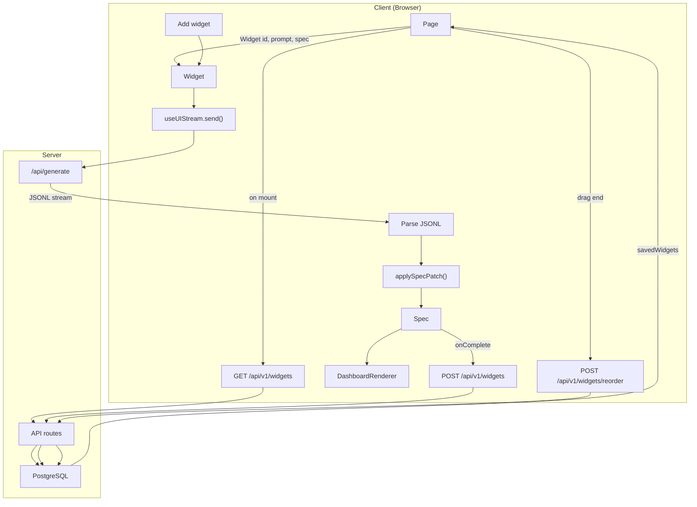

# Dashboard Architecture

The dashboard is a persistent widget grid. Each widget can be generated from a prompt, saved to the DB, and reloaded on the next visit.

---

## Pipeline Diagram

---

## Two Widget Modes

| Mode | When | Data source |
|------|------|-------------|
| **New** | User clicks "Add widget" | Empty. User types prompt, generates. |
| **Saved** | Loaded from DB | `initialPrompt`, `initialSpec` from API |

---

## Step-by-Step

| Step | Where | What happens |
|------|-------|--------------|
| 1 | Page | On mount: `fetch("/api/v1/widgets")` → `SavedWidget[]` |
| 2 | Page | Renders `SortableWidget` for each saved widget with `id`, `prompt`, `spec` |
| 3 | Widget | Receives `initialSpec` → renders via `DashboardRenderer` (no stream) |
| 4 | Widget | For saved widgets with Table/Chart: auto-runs `viewCustomers`, etc. to fetch data |
| 5 | User | Clicks "Add widget" → new `Widget` (no initialSpec) appears |
| 6 | User | Types prompt, hits Enter → `send(prompt)` → `POST /api/generate` |
| 7 | Client | Same as playground: parse JSONL, apply patches, spec updates, render |
| 8 | Client | `onComplete(spec)` → `POST /api/v1/widgets` with `{ prompt, spec }` |
| 9 | Server | `createWidget()` inserts into `widgets` table |
| 10 | Page | `onSaved(id)` → refetch widgets, remove "new" slot |
| 11 | User | Drags widget → `onDragEnd` → `POST /api/v1/widgets/reorder` with `orderedIds` |

---

## Key Files

| Role | File |
|------|------|
| Page | `examples/dashboard/app/page.tsx` |
| Widget | `examples/dashboard/components/widget.tsx` |
| SortableWidget | `examples/dashboard/components/sortable-widget.tsx` |
| Generate API | `examples/dashboard/app/api/generate/route.ts` |
| Widgets API | `examples/dashboard/app/api/v1/widgets/route.ts` |
| DB store | `examples/dashboard/lib/db/store.ts` |
| Schema | `examples/dashboard/lib/db/schema.ts` |
| Catalog | `examples/dashboard/lib/render/catalog.ts` |
| Renderer | `examples/dashboard/lib/render/renderer.tsx` |

---

## Data Flow in One Sentence

**Page loads widgets from DB; each Widget gets id/prompt/spec and renders. New widgets stream from the LLM; on complete, the spec is saved to DB. On reload, saved widgets are reconstituted from DB.**
