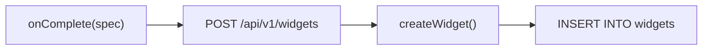
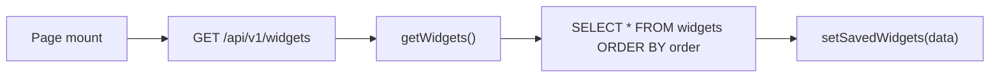
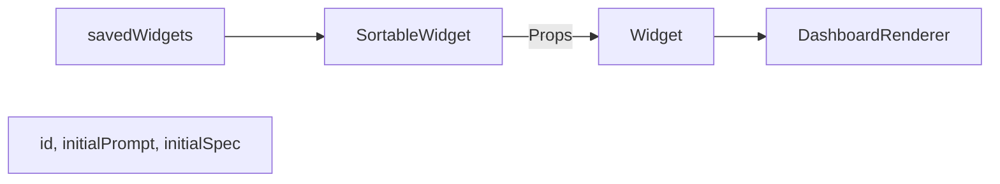
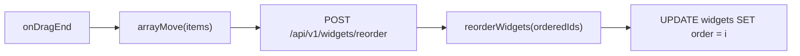

# DB Persistence

How widgets are saved, loaded, reconstituted, and reordered.

---

## Schema

```sql
-- widgets table (Drizzle schema)
widgets (
  id        VARCHAR(50) PRIMARY KEY,
  prompt    TEXT NOT NULL,
  spec      JSONB NOT NULL,
  order     INTEGER NOT NULL DEFAULT 0,
  createdAt TIMESTAMP,
  updatedAt TIMESTAMP
)
```

| Column | Purpose |
|--------|---------|
| `id` | Unique key (e.g. `widget_abc123`) |
| `prompt` | User's text prompt |
| `spec` | Full spec `{ root, elements, state? }` as JSON |
| `order` | Display order (0, 1, 2, ...) |

---

## Save (Persist)

**When:** Generation completes (`useUIStream` `onComplete`).

**Flow:**



**New widget:**
```typescript
// Widget.tsx onComplete
const res = await fetch("/api/v1/widgets", {
  method: "POST",
  body: JSON.stringify({ prompt: currentPrompt, spec: completedSpec }),
});
const saved = await res.json();
setWidgetId(saved.id);
onSaved?.(saved.id);
```

**Edit existing:**
```typescript
await fetch(`/api/v1/widgets/${widgetId}`, {
  method: "PATCH",
  body: JSON.stringify({ prompt, spec: completedSpec }),
});
```

---

## Load (Fetch on Mount)

**When:** Page mounts.

**Flow:**



```typescript
// page.tsx
useEffect(() => {
  fetch("/api/v1/widgets")
    .then(res => res.json())
    .then(data => setSavedWidgets(data.data || []));
}, []);
```

`getWidgets()` returns rows ordered by `order` ascending.

---

## Reconstitute (Re-mount from DB)

**When:** Each saved widget is rendered.

**Flow:**



**Key:** The spec from the DB is passed as `initialSpec`. The Widget does **not** stream; it renders immediately.

```typescript
// sortable-widget.tsx
<Widget
  id={widget.id}
  initialPrompt={widget.prompt}
  initialSpec={widget.spec}
  onDeleted={onDeleted}
/>
```

**In Widget:**
- `currentSpec = spec || initialSpec` — stream spec while generating, or initialSpec when loaded
- `DashboardRenderer` receives `currentSpec` and renders

---

## Auto-Run Data Actions (Reconstitute)

Saved widgets with Tables or Charts need data. On mount, the Widget auto-runs the appropriate action:

1. Scans `spec.elements` for `Table`, `BarChart`, `LineChart` with `statePath`
2. Finds a Button whose `action` matches (e.g. `viewCustomers` for `customers.data`)
3. Calls `executeAction(action, params, setState)` to fetch and populate state

```typescript
// Widget.tsx useEffect
if (dataComponents.includes(element.type) && element.props?.statePath) {
  // Find Button with viewCustomers, viewInvoices, etc.
  executeAction(action, btn.props.actionParams, setState);
}
```

So when you reload the page, a "Customer list" widget fetches customers and the Table shows data.

---

## Reorder (Persist Order)

**When:** User drags a widget and drops it.

**Flow:**



```typescript
// page.tsx handleDragEnd
const newItems = arrayMove(items, oldIndex, newIndex);
fetch("/api/v1/widgets/reorder", {
  method: "POST",
  body: JSON.stringify({ orderedIds: newItems.map(w => w.id) }),
});
setSavedWidgets(newItems);
```

`reorderWidgets(orderedIds)` updates each widget's `order` to match its index in the array.

---

## Summary

| Operation | Trigger | API | Store function |
|-----------|---------|-----|----------------|
| Save | Generation complete | POST /api/v1/widgets | createWidget |
| Update | Edit complete | PATCH /api/v1/widgets/:id | updateWidget |
| Load | Page mount | GET /api/v1/widgets | getWidgets |
| Delete | User deletes | DELETE /api/v1/widgets/:id | deleteWidget |
| Reorder | Drag end | POST /api/v1/widgets/reorder | reorderWidgets |
