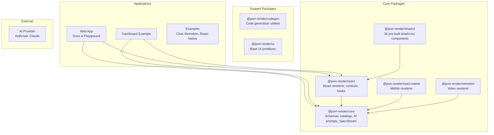
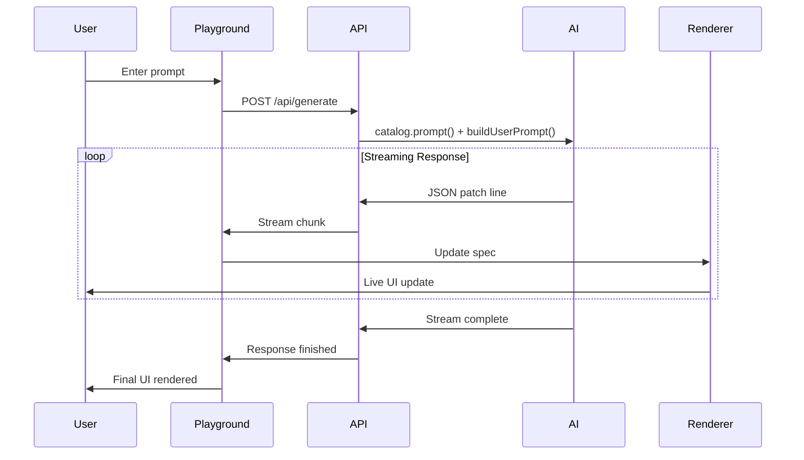

# json-render System Overview

## Introduction

json-render is a **Generative UI** framework that enables AI to generate dynamic user interfaces through structured JSON output. You define a catalog of components and actions; the AI generates JSON specs constrained to that catalog. The system transforms AI-generated JSON patches into live React components, creating a bridge between language models and interactive UI development.

## Core Architecture

The system is built as a monorepo with multiple packages and applications:



## Key Features

### Guardrailed Generation
- AI can only use components in your catalog
- JSON output matches your schema every time
- Predictable, type-safe output

### Real-time Streaming
- Stream and render progressively as the model responds
- SpecStream format with RFC 6902 JSON Patch operations
- Live preview during generation

### Component System
- Type-safe component definitions with Zod schemas
- `defineCatalog` for AI prompt generation
- `defineRegistry` for type-safe component implementations
- Dynamic prop resolution with `$state`, `$cond`, `$bindState`

### Data Management
- State model with JSON Pointer paths
- Built-in actions: `setState`, `pushState`, `removeState`
- Visibility conditions based on state
- Form validation with `checks` and `$bindState`

### Cross-Platform
- React (web) and React Native (mobile) from the same catalog
- Remotion for video timeline specs
- 36 pre-built shadcn/ui components

## Package Structure

| Package | Purpose | Key Exports |
|---------|---------|-------------|
| `@json-render/core` | Schemas, catalogs, AI prompts, SpecStream, dynamic props | `defineSchema`, `defineCatalog`, `buildUserPrompt`, `createSpecStreamCompiler` |
| `@json-render/react` | React renderer, contexts, hooks | `defineRegistry`, `Renderer`, `StateProvider`, `useUIStream` |
| `@json-render/shadcn` | 36 pre-built shadcn/ui components | `shadcnComponentDefinitions`, `shadcnComponents` |
| `@json-render/react-native` | React Native renderer | `defineRegistry`, `Renderer`, `schema` |
| `@json-render/remotion` | Remotion video renderer | `Renderer`, `schema`, timeline spec format |
| `@json-render/codegen` | Code generation tools | Tree traversal, serialization |
| `@json-render/ui` | Base UI primitives | Shared component styles |

## Data Flow



## File Structure

```
ai-json-render/
├── packages/
│   ├── core/           # Schemas, catalogs, SpecStream, prompts
│   ├── react/          # React renderer, contexts, hooks
│   ├── shadcn/         # Pre-built shadcn/ui components
│   ├── react-native/   # React Native renderer
│   ├── remotion/       # Remotion video renderer
│   ├── codegen/        # Code generation utilities
│   └── ui/             # Base UI component library
├── apps/
│   └── web/            # Docs & Playground
├── examples/
│   ├── dashboard/      # Dashboard example
│   ├── chat/           # Chat example
│   └── react-native/   # React Native example
└── docs/
    └── dev/            # Technical documentation
```

## Technology Stack

- **Language**: TypeScript 5.9+
- **Framework**: React 19+ with Next.js 16+
- **Validation**: Zod for runtime type safety
- **Styling**: Tailwind CSS with shadcn/ui components
- **Build System**: Turbo for monorepo management
- **Package Manager**: pnpm with workspaces
- **AI Integration**: Vercel AI SDK with Anthropic provider

## Getting Started

1. **Clone and Install**
   ```bash
   git clone https://github.com/vercel-labs/json-render
   cd json-render
   pnpm install
   ```

2. **Configure Environment**
   - Copy `.env.example` to `.env`
   - Add your Anthropic API key
   - Configure model preferences

3. **Start Development**
   ```bash
   pnpm dev
   ```

4. **Access Applications**
   - http://localhost:3000 - Docs & Playground
   - http://localhost:3001 - Example Dashboard
   - http://localhost:3002 - Remotion Video Example
   - Chat: run `pnpm dev` in `examples/chat`
   - React Native: run `npx expo start` in `examples/react-native`

## Key Concepts

### Specs
UI structures are represented as flat specs with string-based element references:

```typescript
interface Spec {
  root: string;                          // Key of root element
  elements: Record<string, UIElement>;   // Flat element storage
  state?: Record<string, unknown>;       // Optional initial state
}

interface UIElement {
  type: string;              // Component type from catalog
  props: Record<string, unknown>;
  children?: string[];       // Child element keys
  visible?: VisibilityCondition;
}
```

### Catalogs
Catalogs define what components and actions the AI can use:

```typescript
const catalog = defineCatalog(schema, {
  components: {
    Card: { props: z.object({ title: z.string() }), description: "..." },
  },
  actions: {
    submit: { description: "Submit the form" },
  },
});

// Generate AI system prompt
const systemPrompt = catalog.prompt();
```

### Registries
Registries map catalog components to React implementations:

```typescript
const { registry } = defineRegistry(catalog, {
  components: {
    Card: ({ props, children }) => <div className="card">{children}</div>,
  },
});
```

### JSON Patches
Streaming updates use RFC 6902 JSON Patch operations:

```json
{"op":"add","path":"/root","value":"card-1"}
{"op":"add","path":"/elements/card-1","value":{"type":"Card","props":{"title":"Hello"},"children":[]}}
```

## Next Steps

- [Architecture Deep Dive](./02-architecture.md)
- [Component System](./03-component-system.md)
- [Data Flow & Streaming](./04-data-flow.md)
- [API Reference](./05-api-reference.md)
- [Testing Guide](./06-testing.md)
- [Prompt Engineering](./07-prompt-engineering.md)
