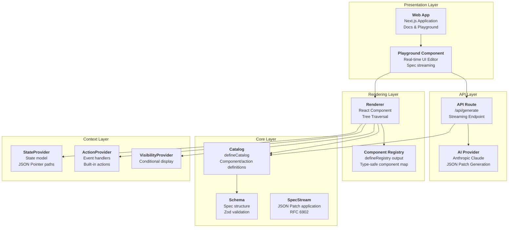
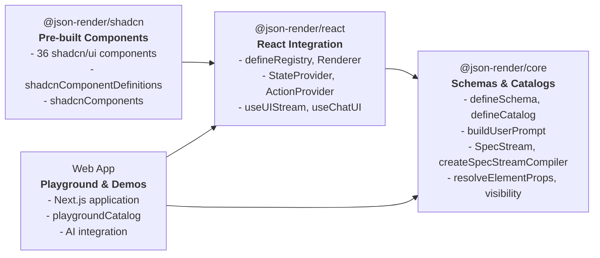
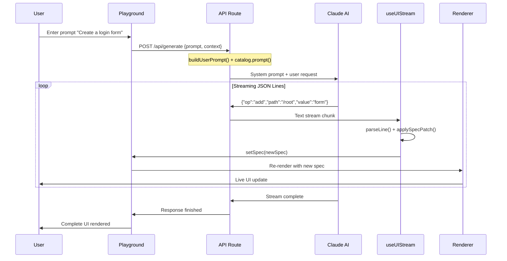
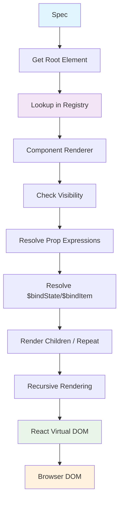

# Architecture Deep Dive

## System Architecture

The json-render system follows a layered architecture with clear separation of concerns:



## Package Dependencies



## Core Abstractions

### 1. Spec Structure

The fundamental structure is the `Spec`:

```typescript
interface Spec {
  root: string;                          // Key of root element
  elements: Record<string, UIElement>;   // Flat storage of all elements
  state?: Record<string, unknown>;        // Optional initial state
}

interface UIElement {
  type: string;              // Component type from catalog
  props: Record<string, unknown>;
  children?: string[];       // Child element keys
  visible?: VisibilityCondition;
  repeat?: { statePath: string; key?: string };  // Repeat over state array
  on?: Record<string, ActionBinding | ActionBinding[]>;  // Event bindings
}
```

*Key insights:*
- **Flat Structure**: Children are referenced by string keys, not nested objects
- **State Model**: Optional `state` provides initial data; StateProvider manages runtime state
- **Event Bindings**: `on` maps event names (e.g. `press`, `change`) to action bindings
- **Repeat**: Elements can repeat over a state array for list rendering

### 2. Catalog System

Catalogs define what the AI can generate:

```typescript
const catalog = defineCatalog(schema, {
  components: {
    Card: {
      props: z.object({ title: z.string(), description: z.string().nullable() }),
      slots: ["default"],
      description: "Container card for content sections",
      example: { title: "Overview", description: "Your account summary" },
    },
    Button: {
      props: z.object({ label: z.string(), variant: z.enum(["primary", "secondary"]).nullable() }),
      events: ["press"],
      description: "Clickable button",
    },
  },
  actions: {
    setState: {
      params: z.object({ statePath: z.string(), value: z.unknown() }),
      description: "Update a value in the state model",
    },
  },
});

// Generate AI system prompt
const systemPrompt = catalog.prompt({ customRules: ["..."] });
```

### 3. Registry System

Registries map catalog components to React implementations:

```typescript
const { registry } = defineRegistry(catalog, {
  components: {
    Card: ({ props, children }) => (
      <div className="card">
        <h3>{props.title}</h3>
        {children}
      </div>
    ),
    Button: ({ props, emit }) => (
      <button onClick={() => emit("press")}>{props.label}</button>
    ),
  },
});

<Renderer spec={spec} registry={registry} />
```

### 4. Component Render Props

Components receive typed props and event handlers:

```typescript
interface ComponentRenderProps<P> {
  element: UIElement<string, P>;  // Element with resolved props
  children?: ReactNode;
  emit: (event: string) => void;    // Fire event (resolves to action bindings)
  on: (event: string) => EventHandle;  // Get event metadata (shouldPreventDefault, bound)
  bindings?: Record<string, string>;   // Prop name -> state path for $bindState
  loading?: boolean;
}
```

## Data Flow Architecture

### 1. Request Flow



### 2. Component Rendering Flow



## Context Management

The system uses multiple React contexts:

### 1. StateProvider
```typescript
<StateProvider initialState={{ user: { name: "John" } }}>
  {children}
</StateProvider>

// In components:
const { state, get, set, update } = useStateStore();
const name = get("/user/name");
set("/user/age", 25);
```

### 2. ActionProvider
```typescript
<ActionProvider handlers={{
  submit: (params) => handleSubmit(params),
  setState: (params) => { /* built-in */ },
}}>
  {children}
</ActionProvider>
```

### 3. VisibilityProvider
```typescript
<VisibilityProvider>
  {children}
</VisibilityProvider>

// Elements use visibility conditions:
{ "visible": { "$state": "/form/hasError" } }
```

### 4. ValidationProvider
```typescript
<ValidationProvider>
  {children}
</ValidationProvider>

// Use validation hooks with checks from catalog
const { errors, validate } = useFieldValidation("/form/email", { checks: [...] });
```

### 5. createRenderer

The `createRenderer` helper wraps Renderer with all providers:

```typescript
const { Renderer } = createRenderer({
  registry,
  initialState: spec?.state,
  handlers: { submit, cancel },
});
```

## Streaming Architecture

### useUIStream Hook

```typescript
const { spec, isStreaming, send, clear, error } = useUIStream({
  api: "/api/generate",
  onComplete: (spec) => { /* ... */ },
  onError: (err) => { /* ... */ },
});

// Send with optional context
await send("Create a login form", {
  previousSpec: currentSpec,  // For refinement (patch-only mode)
  state: { user: { name: "John" } },  // Runtime state context
});
```

### Patch Application

JSON patches follow RFC 6902. Supported paths:
- `/root` - Root element key
- `/elements/{key}` - Element object
- `/elements/{key}/props/{prop}` - Element property
- `/state` - Full state object
- `/state/{path}` - State value at JSON Pointer path

### buildUserPrompt

The API uses `buildUserPrompt` from core:

```typescript
const userPrompt = buildUserPrompt({
  prompt: userInput,
  currentSpec: context?.previousSpec,  // Triggers patch-only mode
  state: context?.state,
  maxPromptLength: 500,
});
```

## Error Handling

### 1. Component Fallbacks
```typescript
const Component = registry[element.type] ?? fallback;
```

### 2. ElementErrorBoundary
Individual elements are wrapped in error boundaries so a single bad component does not crash the page.

### 3. Spec Validation
```typescript
import { validateSpec, autoFixSpec } from "@json-render/core";
const { valid, issues } = validateSpec(spec);
const fixed = autoFixSpec(spec);
```

### 4. Stream Error Recovery
Invalid JSON lines are skipped; parsing continues with valid patches.

## Next Steps

- [Component System Details](./03-component-system.md)
- [Data Flow & Streaming](./04-data-flow.md)
- [API Reference](./05-api-reference.md)
