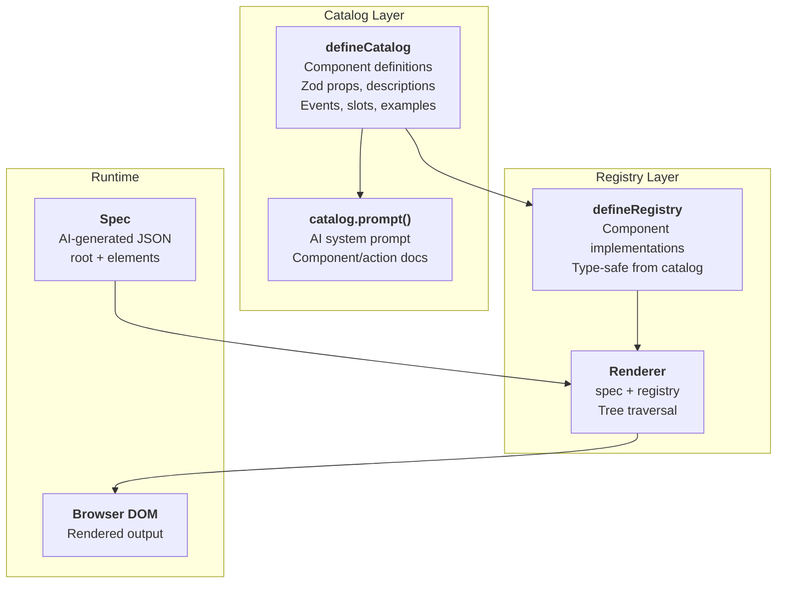

# Component System

## Overview

The json-render component system uses a catalog-driven approach: you define components in a catalog (with Zod props and descriptions), then implement them in a registry. The AI generates specs constrained to your catalog. Components receive typed props, event handlers (`emit`, `on`), and optional bindings for two-way data flow.

## Component Architecture



## Defining a Catalog

Catalogs define what components exist and what props they accept:

```typescript
import { defineCatalog } from "@json-render/core";
import { schema } from "@json-render/react";
import { z } from "zod";

const catalog = defineCatalog(schema, {
  components: {
    Card: {
      props: z.object({
        title: z.string().nullable(),
        description: z.string().nullable(),
        maxWidth: z.enum(["sm", "md", "lg", "full"]).nullable(),
        centered: z.boolean().nullable(),
      }),
      slots: ["default"],
      description: "Container card for content sections",
      example: { title: "Overview", description: "Your account summary" },
    },

    Button: {
      props: z.object({
        label: z.string(),
        variant: z.enum(["primary", "secondary", "danger"]).nullable(),
        disabled: z.boolean().nullable(),
      }),
      events: ["press"],
      description: "Clickable button. Bind on.press for handler.",
      example: { label: "Submit", variant: "primary" },
    },

    Input: {
      props: z.object({
        label: z.string(),
        name: z.string(),
        type: z.enum(["text", "email", "password", "number"]).nullable(),
        placeholder: z.string().nullable(),
        value: z.string().nullable(),
        checks: z.array(z.object({
          type: z.string(),
          message: z.string(),
          args: z.record(z.unknown()).optional(),
        })).nullable(),
      }),
      events: ["submit", "focus", "blur"],
      description: "Text input. Use { $bindState } on value for two-way binding.",
    },
  },
  actions: {
    setState: {
      params: z.object({ statePath: z.string(), value: z.unknown() }),
      description: "Update a value in the state model",
    },
  },
});
```

### Catalog Fields

| Field | Purpose |
|-------|---------|
| `props` | Zod schema for component props |
| `description` | Shown to AI in system prompt |
| `example` | Example props for AI reference |
| `slots` | Slot names (e.g. `["default"]`) for components with children |
| `events` | Event names the component can emit (e.g. `["press"]`, `["change"]`) |

## Defining a Registry

Registries map catalog components to React implementations:

```typescript
import { defineRegistry } from "@json-render/react";
import { catalog } from "./catalog";

const { registry } = defineRegistry(catalog, {
  components: {
    Card: ({ props, children }) => (
      <div className="rounded-lg border p-4">
        {props.title && <h3>{props.title}</h3>}
        {props.description && <p>{props.description}</p>}
        {children}
      </div>
    ),

    Button: ({ props, emit }) => (
      <button
        onClick={() => emit("press")}
        disabled={props.disabled ?? false}
        className={props.variant === "danger" ? "bg-red-500" : "bg-blue-500"}
      >
        {props.label}
      </button>
    ),

    Input: ({ props, bindings }) => {
      const [value, setValue] = useBoundProp(props.value, bindings?.value);
      return (
        <label>
          {props.label}
          <input
            value={value ?? ""}
            onChange={(e) => setValue(e.target.value)}
            placeholder={props.placeholder ?? ""}
          />
        </label>
      );
    },
  },
});
```

## Component Props

Components receive `ComponentRenderProps`:

```typescript
interface ComponentRenderProps<P> {
  element: UIElement<string, P>;  // Element with resolved props
  children?: ReactNode;
  emit: (event: string) => void;  // Fire event (e.g. emit("press"))
  on: (event: string) => EventHandle;  // Get metadata: shouldPreventDefault, bound
  bindings?: Record<string, string>;  // Prop name -> state path for $bindState
  loading?: boolean;
}
```

### emit vs on

- **emit(event)**: Fire the event. Resolves action bindings from `element.on[event]` and executes them.
- **on(event)**: Returns `{ emit, shouldPreventDefault, bound }`. Use when you need to check if a handler is bound or if default should be prevented (e.g. for links):

```tsx
Link: ({ props, on }) => {
  const click = on("click");
  return (
    <a
      href={props.href}
      onClick={(e) => {
        if (click.shouldPreventDefault) e.preventDefault();
        click.emit();
      }}
    >
      {props.label}
    </a>
  );
},
```

### useBoundProp

For form components with `$bindState` or `$bindItem`:

```tsx
const [value, setValue] = useBoundProp(props.value, bindings?.value);
```

## Event Bindings (on)

Elements declare event handlers via the `on` field:

```json
{
  "type": "Button",
  "props": { "label": "Switch Tab" },
  "on": {
    "press": {
      "action": "setState",
      "params": { "statePath": "/activeTab", "value": "settings" }
    }
  }
}
```

Multiple handlers per event:

```json
{
  "on": {
    "press": [
      { "action": "setState", "params": { "statePath": "/tab", "value": "home" } },
      { "action": "buttonClick", "params": { "message": "Tab changed" } }
    ]
  }
}
```

## Dynamic Prop Expressions

Props can use expressions resolved at render time:

### $state - Read from state
```json
{ "label": { "$state": "/user/name" } }
```

### $cond / $then / $else - Conditional
```json
{
  "color": {
    "$cond": { "$state": "/activeTab", "eq": "home" },
    "$then": "#007AFF",
    "$else": "#8E8E93"
  }
}
```

### $bindState - Two-way binding
```json
{
  "type": "Input",
  "props": {
    "value": { "$bindState": "/form/email" },
    "label": "Email"
  }
}
```

### $bindItem - Inside repeat
```json
{
  "type": "Input",
  "props": {
    "value": { "$bindItem": "title" },
    "label": "Title"
  }
}
```

### $item, $index - Repeat scope
```json
{ "$item": "title" }
{ "$index": true }
```

## Visibility Conditions

```json
{
  "type": "Alert",
  "props": { "message": "Error!" },
  "visible": { "$state": "/form/hasError" }
}
```

```json
{
  "visible": [
    { "$state": "/form/hasError" },
    { "$state": "/form/dismissed", "not": true }
  ]
}
```

## Repeat (List Rendering)

Elements can repeat over a state array:

```json
{
  "type": "Stack",
  "props": { "direction": "vertical", "gap": "md" },
  "repeat": { "statePath": "/todos", "key": "id" },
  "children": ["todo-item"]
}
```

Child elements receive `$item` and `$index` in their prop resolution context.

## Built-in Actions

The React schema includes built-in actions (injected into AI prompts automatically):

| Action | Params | Description |
|--------|--------|-------------|
| `setState` | `statePath`, `value` | Update state at path |
| `pushState` | `statePath`, `value`, `clearStatePath?` | Append to array |
| `removeState` | `statePath`, `index` | Remove from array |

## shadcn/ui Components

The `@json-render/shadcn` package provides 36 pre-built components:

```typescript
import { shadcnComponentDefinitions } from "@json-render/shadcn/catalog";
import { shadcnComponents } from "@json-render/shadcn";

const catalog = defineCatalog(schema, {
  components: {
    Card: shadcnComponentDefinitions.Card,
    Stack: shadcnComponentDefinitions.Stack,
    Button: shadcnComponentDefinitions.Button,
  },
  actions: {},
});

const { registry } = defineRegistry(catalog, {
  components: {
    Card: shadcnComponents.Card,
    Stack: shadcnComponents.Stack,
    Button: shadcnComponents.Button,
  },
});
```

## Adding New Components

1. **Add to catalog**:
   ```typescript
   MyComponent: {
     props: z.object({ title: z.string() }),
     description: "My custom component",
     events: ["press"],
   },
   ```

2. **Implement in registry**:
   ```typescript
   MyComponent: ({ props, emit }) => (
     <div onClick={() => emit("press")}>{props.title}</div>
   ),
   ```

3. **AI prompt** is generated automatically from the catalog via `catalog.prompt()`.

## Next Steps

- [Data Flow & Streaming](./04-data-flow.md)
- [API Reference](./05-api-reference.md)
- [Testing Guide](./06-testing.md)
