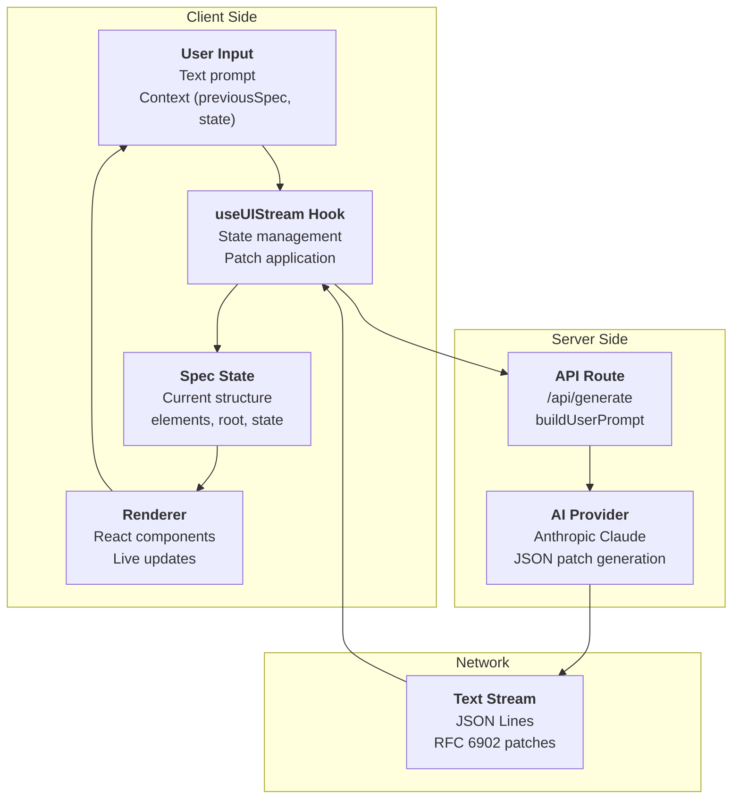
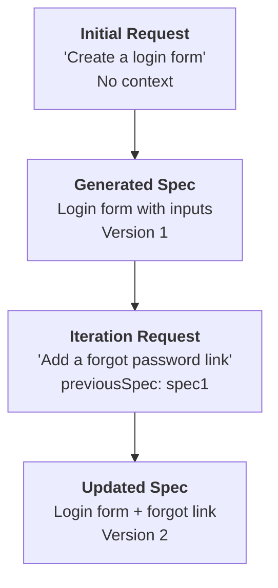

# Data Flow & Streaming

## Overview

The json-render system implements real-time streaming where AI-generated JSON patches are applied incrementally to build specs. This enables live preview during generation and seamless iteration on existing UIs. The API uses `buildUserPrompt` for prompt construction and `catalog.prompt()` for the system prompt.

## Streaming Architecture



## useUIStream Hook

```typescript
const { spec, isStreaming, send, clear, error } = useUIStream({
  api: "/api/generate",
  onComplete: (spec) => { /* ... */ },
  onError: (err) => { /* ... */ },
});

// Fresh generation
await send("Create a login form");

// Refinement (patch-only mode)
await send("Add a forgot password link", {
  previousSpec: currentSpec,
});

// With state context
await send("Show my todos", {
  state: { todos: [{ text: "Buy milk" }] },
});
```

### Stream Processing

The hook:
1. POSTs to the API with `{ prompt, context }`
2. Reads the response as a text stream
3. Parses each line as JSON (patch or metadata)
4. Applies patches via `applySpecPatch` from `@json-render/core`
5. Updates spec state, triggering re-renders

## buildUserPrompt

The API uses `buildUserPrompt` from `@json-render/core`:

```typescript
import { buildUserPrompt } from "@json-render/core";

const userPrompt = buildUserPrompt({
  prompt: userInput,
  currentSpec: context?.previousSpec,  // Triggers patch-only mode
  state: context?.state,
  maxPromptLength: 500,
});
```

### Modes

| Mode | When | Output |
|------|------|--------|
| Fresh | No `currentSpec` | User prompt only |
| Refinement | `currentSpec` provided | Current spec JSON + "USER REQUEST: ..." + patch instructions |
| With state | `state` provided | Optional state context for data-aware generation |

## JSON Patch System

### Patch Format (RFC 6902)

```typescript
interface JsonPatch {
  op: "add" | "remove" | "replace" | "move" | "copy" | "test";
  path: string;
  value?: unknown;
}
```

### Supported Paths

| Path | Purpose |
|------|---------|
| `/root` | Root element key |
| `/elements/{key}` | Full element object |
| `/elements/{key}/props/{prop}` | Element property |
| `/state` | Full state object |
| `/state/{jsonPointer}` | State value (e.g. `/state/todos`) |

### Patch Examples

**Set root:**
```json
{"op":"add","path":"/root","value":"card-1"}
```

**Add element:**
```json
{
  "op":"add",
  "path":"/elements/card-1",
  "value":{
    "type":"Card",
    "props":{"title":"Welcome"},
    "children":["btn-1"]
  }
}
```

**Update property:**
```json
{"op":"replace","path":"/elements/card-1/props/title","value":"Hello"}
```

**Remove element:**
```json
{"op":"remove","path":"/elements/old-element"}
```

## API Route Implementation

```typescript
// apps/web/app/api/generate/route.ts
import { streamText } from "ai";
import { buildUserPrompt } from "@json-render/core";
import { playgroundCatalog } from "@/lib/render/catalog";

const SYSTEM_PROMPT = playgroundCatalog.prompt({
  customRules: [
    "NEVER use viewport height classes...",
    "For forms: use Card as root with maxWidth:'sm'...",
  ],
});

export async function POST(req: Request) {
  const { prompt, context } = await req.json();

  const userPrompt = buildUserPrompt({
    prompt,
    currentSpec: context?.previousSpec,
    maxPromptLength: 500,
  });

  const result = streamText({
    model: process.env.AI_GATEWAY_MODEL || "anthropic/claude-haiku-4.5",
    system: SYSTEM_PROMPT,
    prompt: userPrompt,
    temperature: 0.7,
  });

  return new Response(result.textStream, {
    headers: { "Content-Type": "text/plain; charset=utf-8" },
  });
}
```

## Iteration Flow



**Context structure:**
```typescript
{
  prompt: "Add a forgot password link",
  context: {
    previousSpec: {
      root: "login-form",
      elements: { /* existing elements */ }
    }
  }
}
```

## SpecStream Compiler (Low-Level)

For custom streaming logic, use `createSpecStreamCompiler`:

```typescript
import { createSpecStreamCompiler } from "@json-render/core";

const compiler = createSpecStreamCompiler<MySpec>();

// Process chunks as they arrive
const chunk = await reader.read();
const { result, newPatches } = compiler.push(chunk);
setSpec(result);

// Get final result
const finalSpec = compiler.getResult();
```

## Chat Mode (Mixed Streams)

For chat UIs that mix prose and UI, use the transform:

```typescript
import { createJsonRenderTransform, pipeJsonRender } from "@json-render/core";

// Client: separate text from spec data in stream
const transform = createJsonRenderTransform();

// Server: pipe mixed stream through transform
const stream = pipeJsonRender(mixedStream);
```

## Error Handling

### Patch Parsing
Invalid JSON lines are skipped; processing continues with valid patches.

### Stream Errors
```typescript
useUIStream({
  api: "/api/generate",
  onError: (err) => {
    console.error("Generation failed:", err);
    toast.error("Failed to generate UI");
  },
});
```

### Request Cancellation
Starting a new `send()` aborts the previous request.

## Performance

- **Immediate feedback**: UI appears as first patches arrive
- **Incremental updates**: Only changed elements re-render
- **Immutable updates**: Structural sharing for efficient React reconciliation
- **Stable keys**: Element keys enable efficient reconciliation

## Next Steps

- [API Reference](./05-api-reference.md)
- [Testing Guide](./06-testing.md)
- [Prompt Engineering](./07-prompt-engineering.md)
