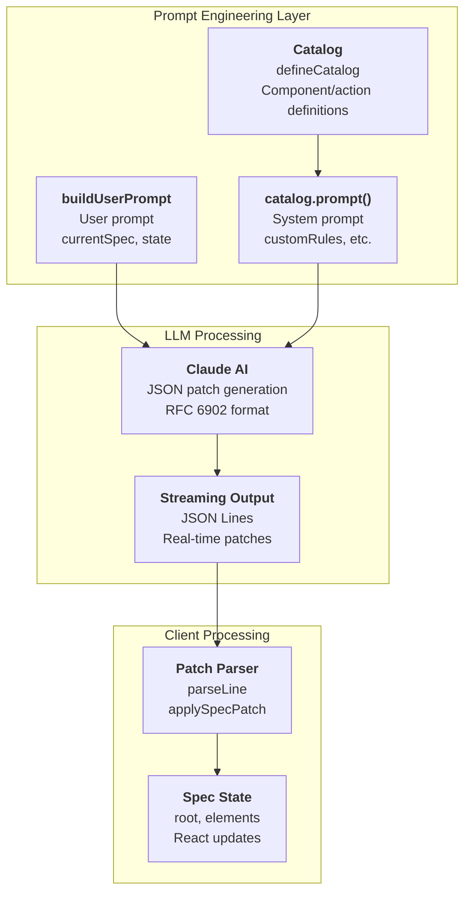

# Prompt Engineering & LLM Interaction

## Overview

The json-render system uses a catalog-driven approach to prompt engineering. The catalog defines components and actions; `catalog.prompt()` generates the AI system prompt. User prompts are built with `buildUserPrompt`, which handles fresh generation, refinement (patch-only mode), and optional state context.

## System Architecture for LLM Integration



## Catalog-Driven System Prompts

### catalog.prompt()

The catalog generates the system prompt from component and action definitions:

```typescript
const systemPrompt = catalog.prompt();
```

### Custom Rules

```typescript
const systemPrompt = catalog.prompt({
  customRules: [
    "NEVER use viewport height classes (min-h-screen, h-screen) - the UI renders inside a fixed-size container.",
    "NEVER use page background colors (bg-gray-50) - the container has its own background.",
    "For forms: use Card as root with maxWidth:'sm' and centered:true.",
    "For content-heavy UIs: use Stack or Grid as root.",
    "Use realistic, professional sample data. Include 3-5 items.",
    "For form inputs, always include checks for validation and pair with $bindState on value.",
  ],
});
```

### How It Works

The catalog's `prompt()` method:
1. Lists all components with their props (from Zod schemas) and descriptions
2. Lists all actions with params and descriptions
3. Includes built-in actions (setState, pushState, removeState) automatically
4. Injects default rules (output format, patch structure)
5. Appends custom rules when provided

## buildUserPrompt

User prompts are built with `buildUserPrompt` from `@json-render/core`:

```typescript
import { buildUserPrompt } from "@json-render/core";

// Fresh generation
const prompt = buildUserPrompt({ prompt: "create a todo app" });

// Refinement (patch-only mode)
const prompt = buildUserPrompt({
  prompt: "add a dark mode toggle",
  currentSpec: existingSpec,
});

// With state context
const prompt = buildUserPrompt({
  prompt: "show my data",
  state: { todos: [{ text: "Buy milk" }] },
});

// With max length
const prompt = buildUserPrompt({
  prompt: userInput,
  maxPromptLength: 500,
});
```

### Refinement Mode

When `currentSpec` is provided, the prompt includes:
1. "CURRENT UI STATE (already loaded, DO NOT recreate existing elements)"
2. Full spec as JSON
3. "USER REQUEST: {user prompt}"
4. Patch instructions (add, replace, remove, update root, add children)
5. "DO NOT output patches for elements that don't need to change"

## JSON Patch Format for LLMs

### Output Format

The AI outputs JSON Lines. Each line is a patch:

```json
{"op":"add","path":"/root","value":"card-1"}
{"op":"add","path":"/elements/card-1","value":{"type":"Card","props":{"title":"Hello"},"children":["btn-1"]}}
{"op":"add","path":"/elements/btn-1","value":{"type":"Button","props":{"label":"Click"},"children":[]}}
```

### Supported Operations (RFC 6902)

| op | Purpose |
|----|---------|
| add | Add root, element, or property |
| replace | Update root or element |
| remove | Remove element |

### Path Conventions

| Path | Purpose |
|------|---------|
| `/root` | Root element key |
| `/elements/{key}` | Full element object |
| `/elements/{key}/props/{prop}` | Element property |
| `/state` | Full state object |
| `/state/{path}` | State value (JSON Pointer) |

## API Route Pattern

```typescript
// apps/web/app/api/generate/route.ts
import { streamText } from "ai";
import { buildUserPrompt } from "@json-render/core";
import { playgroundCatalog } from "@/lib/render/catalog";

const SYSTEM_PROMPT = playgroundCatalog.prompt({
  customRules: [
    "NEVER use viewport height classes...",
    "For forms: use Card as root with maxWidth:'sm'...",
  ],
});

export async function POST(req: Request) {
  const { prompt, context } = await req.json();

  const userPrompt = buildUserPrompt({
    prompt,
    currentSpec: context?.previousSpec,
    maxPromptLength: 500,
  });

  const result = streamText({
    model: process.env.AI_GATEWAY_MODEL || "anthropic/claude-haiku-4.5",
    system: SYSTEM_PROMPT,
    prompt: userPrompt,
    temperature: 0.7,
  });

  return new Response(result.textStream, {
    headers: { "Content-Type": "text/plain; charset=utf-8" },
  });
}
```

## Catalog Definition Best Practices

### Component Descriptions

- Be specific about use cases and constraints
- Include "Has children" when applicable
- Mention data binding: "Use { $bindState } on value for two-way binding"
- Include validation: "Use checks for validation (e.g. required, email)"

### Example Props

Provide `example` for complex components:

```typescript
Table: {
  props: z.object({ ... }),
  description: "Data table...",
  example: {
    columns: ["Name", "Role"],
    rows: [["Alice", "Admin"], ["Bob", "User"]],
  },
},
```

### Events

Declare `events` so the AI knows what to bind:

```typescript
Button: {
  props: z.object({ ... }),
  events: ["press"],
  description: "Clickable button. Bind on.press for handler.",
},
```

## Common Issues & Solutions

| Issue | Cause | Solution |
|-------|-------|----------|
| Invalid JSON | Missing quotes/commas | Add format validation examples to customRules |
| Wrong component types | Unclear descriptions | Improve component descriptions, add examples |
| Missing children refs | Incomplete hierarchy | Emphasize parent-first, children as keys |
| Non-responsive design | Ignoring mobile-first | Add responsive design rules |
| Excessive patches | Not understanding refinement | buildUserPrompt handles this; ensure currentSpec is passed |
| Viewport classes | AI uses min-h-screen | Add to customRules: "NEVER use viewport height classes" |

## Debugging Prompts

### Inspect Generated Prompt

```typescript
const systemPrompt = catalog.prompt({ customRules: [...] });
console.log(systemPrompt);

const userPrompt = buildUserPrompt({ prompt: "create a form", currentSpec });
console.log(userPrompt);
```

### Test with Different Catalogs

Create minimal catalogs for debugging:

```typescript
const minimalCatalog = defineCatalog(schema, {
  components: {
    Card: { props: z.object({ title: z.string() }), description: "Card" },
    Button: { props: z.object({ label: z.string() }), description: "Button" },
  },
  actions: {},
});
```

## Conclusion

The json-render prompt engineering flow:

1. **Catalog** defines components and actions; `catalog.prompt()` generates the system prompt
2. **buildUserPrompt** constructs user prompts with optional refinement and state context
3. **API route** combines both and streams to the AI
4. **Client** applies patches incrementally for live UI updates

Key benefits:
- **Single source of truth**: Catalog drives both AI prompts and type-safe registries
- **Refinement support**: buildUserPrompt handles patch-only mode automatically
- **Extensible**: Custom rules and state context for app-specific needs
