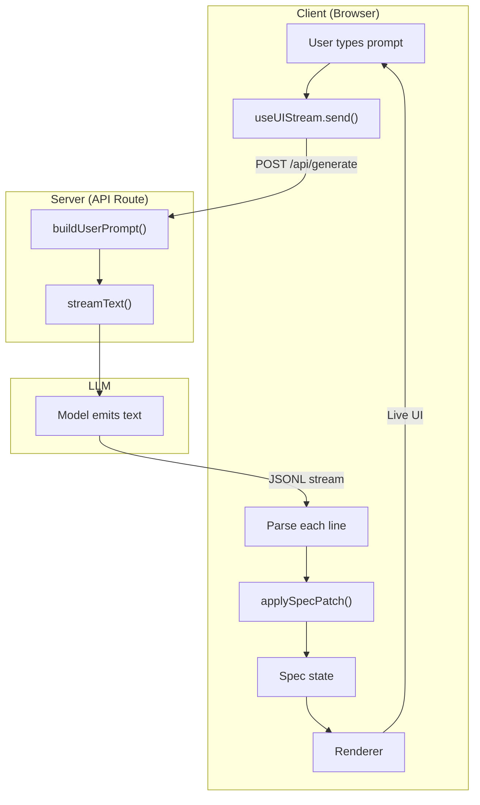

# Playground Architecture

The playground turns a text prompt into a live UI. Here's the pipeline.

---

## Pipeline Diagram

---

## Step-by-Step

| Step | Where | What happens | Code reference |
|------|-------|--------------|----------------|
| 1 | Client | User types "Create a login form" and hits Enter | `apps/web/components/playground.tsx` 204-234 |
| 2 | Client | `useUIStream.send(prompt, { previousSpec })` POSTs to `/api/generate` | `packages/react/src/hooks.ts` 265-294, 222-223 |
| 3 | Server | `buildUserPrompt()` builds the user message (fresh or refinement) | `apps/web/app/api/generate/route.ts` 51-56 |
| 4 | Server | `streamText()` calls the LLM with system prompt + user prompt | `apps/web/app/api/generate/route.ts` 58-64 |
| 5 | LLM | Model streams plain text: one JSON object per line (JSONL) | `apps/web/app/api/generate/route.ts` 68-73 |
| 6 | Client | `useUIStream` reads the stream, splits by newline | `packages/react/src/hooks.ts` 317-328 |
| 7 | Client | Each line: `JSON.parse()` → if valid patch, `applyPatch(spec, patch)` | `packages/react/src/hooks.ts` 41-65, 330-341 |
| 8 | Client | Spec state updates → React re-renders → Renderer shows UI | `packages/react/src/hooks.ts` 339-340; `apps/web/components/playground.tsx` 676, 915 (PlaygroundRenderer); `apps/web/lib/render/renderer.tsx` 71-93 |

---

## Key Files

| Role | File | Lines |
|------|------|-------|
| API route | `apps/web/app/api/generate/route.ts` | 24-95 |
| Client hook | `packages/react/src/hooks.ts` (useUIStream) | 241-391 |
| System prompt | `apps/web/lib/render/catalog.ts` (playgroundCatalog.prompt) | 10-19 |
| User prompt | `packages/core/src/prompt.ts` (buildUserPrompt) | 61-104 |
| Patch apply | `packages/react/src/hooks.ts` (applyPatch) | 163-204 |
| Renderer | `apps/web/lib/render/renderer.tsx` (PlaygroundRenderer) | 71-93 |

---

## Data Flow in One Sentence

**The LLM outputs JSONL patches; the client parses each line and applies them to a spec; the Renderer turns the spec into React components.**
