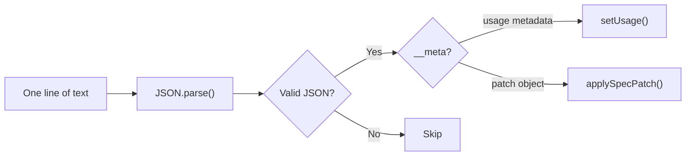

# JSONL and Patches

What the LLM returns, and how we turn it into a spec.

---

## What the LLM Actually Returns

**Plain text.** Not structured JSON, not a schema-validated object. The model streams raw text, one line at a time.

Each line is a JSON object. That format is called **JSONL** (JSON Lines): one valid JSON object per line, newline-separated.

> **Code:** `apps/web/app/api/generate/route.ts` 68-73 streams `result.textStream` directly; no `response_format` or schema. `packages/react/src/hooks.ts` 317-324 reads chunks, splits by `\n`.

Example stream:

```
{"op":"add","path":"/root","value":"card"}
{"op":"add","path":"/elements/card","value":{"type":"Card","props":{"title":"Login"},"children":["email","password","btn"]}}
{"op":"add","path":"/elements/email","value":{"type":"Input","props":{"label":"Email","name":"email"},"children":[]}}
{"op":"add","path":"/elements/password","value":{"type":"Input","props":{"label":"Password","type":"password"},"children":[]}}
{"op":"add","path":"/elements/btn","value":{"type":"Button","props":{"label":"Sign in"},"on":{"press":{"action":"formSubmit"}},"children":[]}}
{"op":"add","path":"/state/form","value":{"email":"","password":""}}
{"__meta":"usage","promptTokens":1234,"completionTokens":89,"totalTokens":1323}
```

> **Code:** Usage metadata appended by `apps/web/app/api/generate/route.ts` 76-84 after stream completes.

---

## RFC 6902 JSON Patch

Each patch line follows [RFC 6902](https://datatracker.ietf.org/doc/html/rfc6902):

| Field | Meaning |
|-------|---------|
| `op` | Operation: `add`, `remove`, `replace`, `move`, `copy`, `test` |
| `path` | Where to apply it (e.g. `/root`, `/elements/card`, `/state/form`) |
| `value` | The data (for add/replace) |

Paths we use:

- `/root` — which element is the root (string key)
- `/elements/<key>` — add or replace an element
- `/state` or `/state/<path>` — initial or updated state

> **Code:** Path handling in `packages/react/src/hooks.ts` 71-109 (setSpecValue), 116-147 (removeSpecValue).

---

## Why No Structured Output?

We do **not** use:

- JSON schema / `outputSchema` / `response_format`
- Structured output modes
- Server-side validation of the full response

**Reason:** We want **streaming**. The UI should update as each patch arrives. Structured output typically waits for the full response, which would delay the first render.

**Trade-off:** The model can emit invalid lines (markdown, explanations, malformed JSON). We handle that by **ignoring** them.

> **Code:** `streamText()` has no `experimental_output` or schema. `apps/web/app/api/generate/route.ts` 58-64.

---

## How the Client Parses



In code:

1. Split stream by `\n`, trim each line — `packages/react/src/hooks.ts` 327-328
2. For each line: `JSON.parse(line)` — `packages/react/src/hooks.ts` 47
3. If parse throws → **skip** (invalid line, no crash) — `packages/react/src/hooks.ts` 62-64 (catch returns null)
4. If `parsed.__meta === "usage"` → store token usage — `packages/react/src/hooks.ts` 50-59, 335-336
5. Else → treat as patch, call `applyPatch(spec, parsed)` — `packages/react/src/hooks.ts` 339-340
6. Update spec state → React re-renders — `packages/react/src/hooks.ts` 340

**Invalid lines are dropped.** The spec only changes when we successfully parse and apply a patch.

---

## What "Guaranteed" Output Means

We don't guarantee the LLM outputs valid patches. We guarantee:

1. **Prompt** — The system prompt tells the model exactly what format to use
2. **Catalog** — Only listed components and actions are valid
3. **Parsing** — We only apply lines that parse as valid JSON and look like patches

If the model outputs "Here's your form:" or `{"broken":` — we skip it. The UI keeps whatever we've applied so far.

---

## Summary

| Question | Answer |
|----------|--------|
| What does the LLM return? | Plain text, JSONL (one JSON object per line) |
| Is it schema-validated? | No |
| What if a line is invalid? | We skip it |
| Why not structured output? | We need streaming; patches apply incrementally |
