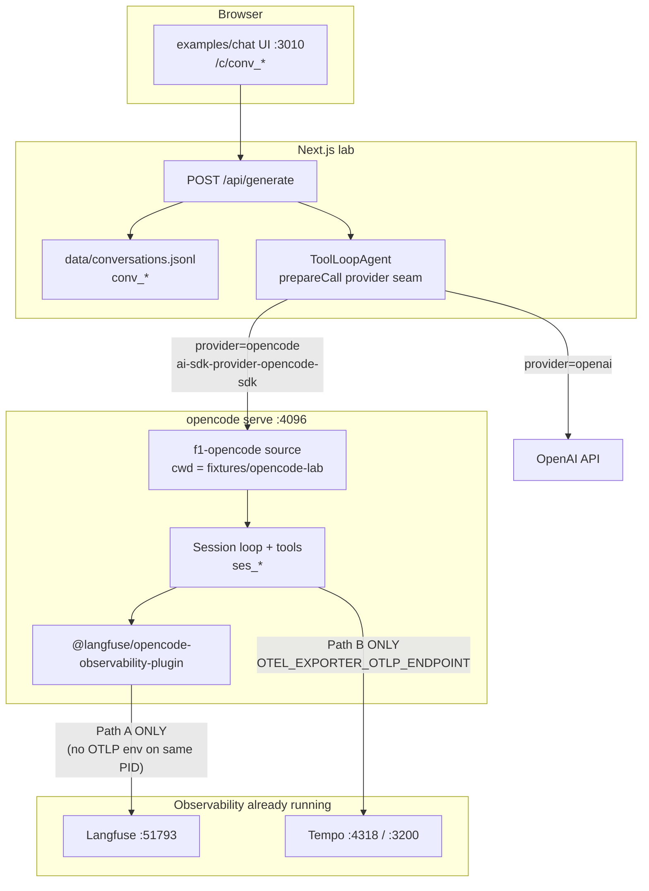

# ARCHITECTURE — What we have today (2026-08-02)

> **Repo:** `ai-json-render` · **Lab:** `examples/chat`  
> **Branch:** `feat/freeze-spec-with-ai-sdk-state-bridge-using-ai-sdk-opencode-provider`  
> **Why this doc exists:** the stack is awesome and real — but half of what makes it work lives
> **outside git** (OpenCode global config, machine auth, Docker observability). The **lab workspace**
> is in git: [`../../fixtures/opencode-lab/`](../../fixtures/opencode-lab/).  
> **Doc index:** [`INDEX.md`](./INDEX.md) · **Success bar:** [`MILESTONE-0802-GOLD-STANDARD.md`](./MILESTONE-0802-GOLD-STANDARD.md)

**Companion receipts**

| Doc | Role |
|---|---|
| [`INDEX.md`](./INDEX.md) | Read order + canonical facts |
| [`MILESTONE-0802-GOLD-STANDARD.md`](./MILESTONE-0802-GOLD-STANDARD.md) | **MAJOR MILESTONE** — gold standard for other experiments |
| [`FUTURE-TICKET-meridian-opencode-agents.md`](./FUTURE-TICKET-meridian-opencode-agents.md) | Tune via OpenCode agent create (primary \| sub \| both) |
| [`OUT-OF-GIT-CONFIG.md`](./OUT-OF-GIT-CONFIG.md) | Machine secrets/env + what moved into `fixtures/opencode-lab` |
| [`FINDINGS.md`](./FINDINGS.md) | Provider lab 8/8 + control-plane `?directory=` |
| [`JOURNAL-0802-serve-telemetry-e2e.md`](./JOURNAL-0802-serve-telemetry-e2e.md) | Langfuse / Tempo E2E + dual-boot conflict |
| [`JOURNAL-0802-aisdk-langfuse.md`](./JOURNAL-0802-aisdk-langfuse.md) | Next AI SDK → Langfuse (`conv_*` sessions) |
| [`JOURNAL-0802-variant-effort.md`](./JOURNAL-0802-variant-effort.md) | Shared effort dial → serve `variant` |
| [`JOURNAL-0802-chat-qol.md`](./JOURNAL-0802-chat-qol.md) | URL SSOT, provider toggle, telemetry hook |
| Marketplace `JOURNAL-0802-serve-observability.md` | Path A/B research + §9 E2E (under `f1-monorepo/apps/meridian-marketplace/plans.documented/07-20-2026-meridian-marketplace-heart-transplant-again/`) |
| Marketplace `JOURNAL-0802-architecture-map.md` | Pointer back to this map + out-of-git inventory |
| [`README.md`](../../README.md) | Boot runbook |

---

## 1. One paragraph

We run a **Next.js chat lab** that can talk to **either** Vercel AI SDK → OpenAI **or** a stock
**`opencode serve`** (f1-opencode from source) through the community package
`ai-sdk-provider-opencode-sdk`. Conversation identity is the URL (`/c/[id]`); OpenCode sessions are
`ses_*` metadata on assistant messages. Reasoning effort is one UI dial: OpenAI gets
`providerOptions.openai.reasoningEffort`, OpenCode gets official prompt body **`variant`**. Product
eyes for serve turns are **Langfuse** via the official OpenCode plugin (Path A). Engine/infra spans
are **Tempo** via `OTEL_EXPORTER_OTLP_ENDPOINT` (Path B). **Do not enable both on one serve PID** —
they fight over the global OTEL provider. Zero fork source delta for this lab.

---

## 2. Runtime topology (measured)

### Ports (lab machine, 2026-08-02 afternoon)

| Service | Port | Role |
|---|---|---|
| Chat Next | **3010** | Lab UI + `/api/generate` (direct Next; portless optional) |
| `opencode serve` | **4096** | Headless OpenCode HTTP/OpenAPI |
| Langfuse web | **51793** | Generations / turns / cost eyes |
| Tempo | **4318** OTLP HTTP, **3200** query | Engine spans |
| Grafana / Loki / Prometheus | 51792 / 51790 / 51791 | f1-infra stack (present; not required for Path A) |

---

## 3. In-repo pieces (git)

### Chat app (`ai-json-render/examples/chat`)

| Piece | What it does |
|---|---|
| `app/c/[id]/page.tsx` | Conversation SSOT in the URL; provider + model + **effort** selectors |
| `app/api/generate/route.ts` | Streams agent; logs `provider` / `model` / `effort` / `conversationId` / `sessionId` |
| `lib/agent.ts` | `ToolLoopAgent`; `prepareCall` switches OpenAI vs Opencode; clamps effort |
| `lib/model.ts` | Server-only OpenCode client; passes `variant`, `sessionId`, `systemPrompt`, `directory` |
| `lib/chat-provider.ts` | Client-safe helpers (`toOpencodeModelId`) — **never** import `lib/model.ts` in the browser |
| `lib/openai-model-matrix.ts` | Code-owned model + effort allow-lists |
| `data/conversations.jsonl` | Local conversation DB (gitignored content; path is in-repo) |
| `ai-sdk-provider-opencode-sdk` | Community adapter: AI SDK LanguageModel ↔ serve HTTP |

### Engine (consumed, not edited for this lab)

| Piece | What it does |
|---|---|
| `~/code/f1-studio/f1-opencode` | Fork we boot from source (`bun …/src/index.ts serve`) |
| OpenAPI `/doc` | SSOT for prompt fields including **`variant`** |
| Machine auth | `~/.local/share/opencode/auth.json` — **global**, not per-repo |

**Fork git tree stays clean** for this arc — install hygiene + config/env only.

---

## 4. Data plane: two IDs, one conversation

| ID | Owner | Where you see it |
|---|---|---|
| `conv_*` | Chat app | URL `/c/conv_…`, JSONL store, generate breadcrumb |
| `ses_*` | OpenCode serve | Assistant `metadata.opencodeSessionId`, Langfuse session, serve `/session/:id` |

Correlation today is **manual / metadata**, not a shared OTEL trace across Next → serve. Next
exports AI SDK spans via `instrumentation.ts` + `LangfuseSpanProcessor`; Langfuse `sessionId` is
`conv_*` from `withLangfuseTrace` on `/api/generate`. OpenCode Path A still owns `ses_*` /
`opencode.turn` on the serve process.

---

## 5. Control plane: directory is law

Serve tools, permissions, and questions are **workspace-scoped**. Unscoped
`GET /permission` / `GET /question` 404 or pass vacuously.

- Chat sets `OPENCODE_DIRECTORY` to absolute `examples/chat/fixtures/opencode-lab`
- Adapter passes `directory` on requests
- Live suite uses `serveUrl()` with `?directory=`
- Serve **cwd** must be that same directory so project `opencode.json` loads

**Never assume serve process cwd alone** in containers (and never rely on the obsolete `/tmp/opencode-lab-scratch`).

---

## 6. Observability architecture

### Path A — Langfuse plugin (clinician eyes)

- Config: [`fixtures/opencode-lab/opencode.json`](../../fixtures/opencode-lab/opencode.json) → `plugin` + `experimental.openTelemetry: true`
- Creds: `~/.config/opencode/opencode-langfuse.json` **and/or** serve env
- **Must set `LANGFUSE_BASEURL`** (no underscore) → `http://127.0.0.1:51793`
- Chat `.env.local` has `LANGFUSE_BASE_URL` (underscore) for the **Next AI SDK exporter** — **that name does not steer the plugin**
- Proved: trace `be52ce35234667179207cbfbca858248` (`opencode.turn`)

### Next AI SDK → Langfuse (fair OpenAI compare)

- `instrumentation.ts` → `registerLangfuseOtel()` → `LangfuseSpanProcessor`
- `/api/generate` → `wrapLangfuseRoute` + `withLangfuseTrace({ sessionId: conversationId })`
- Agent → `aiTelemetry({ functionId: "examples-chat-generate" })`
- Env: `LANGFUSE_PUBLIC_KEY` / `LANGFUSE_SECRET_KEY` / `LANGFUSE_BASE_URL` (kill switch `AI_TELEMETRY=0`)
- Receipt: [`JOURNAL-0802-aisdk-langfuse.md`](./JOURNAL-0802-aisdk-langfuse.md)

### Path B — OTLP → Tempo (engine spans)

- Env only: `OTEL_EXPORTER_OTLP_ENDPOINT=http://127.0.0.1:4318`
- Proved: `service.name=opencode` spans in Tempo

### Dual-boot — **CONFLICT** (law)

Same PID with Langfuse env **and** `OTEL_EXPORTER_OTLP_ENDPOINT` → Tempo wins; Langfuse
`opencode.turn` goes dark. Hypothesis: Effect `NodeSdk` vs plugin `NodeSDK` fight for the global
tracer provider.

**Lab default:** Path A only on `:4096`.

---

## 7. Effort / thinking dial

Official serve field `variant` on `POST /session/:id/message`. Adapter
`OpencodeSettings.variant`. UI effort select works for **both** providers; matrix clamp shared.

Proved on session model: `{ providerID: "openai", modelID: "gpt-5.6-luna", variant: "low" }`.

---

## 8. Hard holes (still true)

1. **`question.asked`** → stream error; session blocks until `POST /question/:id/reply` (sidecar).
2. **Client tools** ignored (serve executes tools); loud warnings.
3. **Next ↔ serve Langfuse** still not one shared OTEL trace — correlate `conv_*` (app) with `ses_*` (Path A) manually.
4. **No OTel collector** — Path B logs to Tempo `/v1/logs` 404.
5. **Dual Path A+B** on one serve — forbidden until separated.

---

## 9. What “awesome” means for Meridian

This lab is the **serve-first** existence proof:

- Stock serve + AI SDK client is enough for free-form + Mode B-style text contracts
- Observability Path A restores “Langfuse is your eyes” without forking OpenCode
- Effort is a first-class server field — no hackery
- Out-of-git config is intentional and now **inventoried** ([`OUT-OF-GIT-CONFIG.md`](./OUT-OF-GIT-CONFIG.md))

Next Meridian experiments should treat Path A boot + `?directory=` as **setup**, not epilogue.
