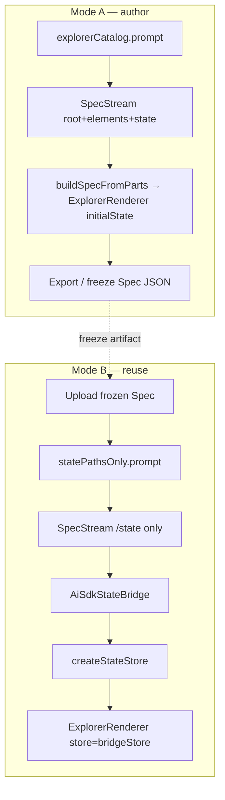

# PRD — Freeze the Spec, stream the state

> Reads after [`VISION.md`](./VISION.md). Execution contract for `examples/chat`.  
> Prefix **ASB** (AiSdk State Bridge / Author→Stream-state).  
> **Live status:** [`tickets/INDEX.md`](./tickets/INDEX.md) (this PRD does not track day-to-day board).  
> Branch: `feat/freeze-spec-with-ai-sdk-state-bridge`.

---

## 0 · Status (2026-07-23)

**Milestone 1 is complete.** Goals G1–G5 below are satisfied on the branch. Wave barriers 0–4 shipped; Wave 5 (OpenAI model matrix) shipped as lab DX.

| Milestone | Scope | State |
|---|---|---|
| **1** | Bridge → paint → path-mined prompt → Mode A/B chat UX (+ model matrix) | 🟢 DONE |
| **2** | Envelope-persisted frozen Spec; Mode B export dump; fixture dedupe | ⬜ OPEN (see ASB-008…010) |

Do not treat “⭐ START HERE: Wave 1” as current work — that gate already passed.

---

## 1 · Problem

json-render chat is excellent at **authoring** Specs (Mode A). It was weak at **reusing** a Spec we already liked:

- Regenerating the full SpecStream re-rolls layout.
- `ExplorerRenderer` historically bound `StateProvider` to `spec.state` only — no live writer from AI SDK parts into a store while Spec stayed frozen.
- Dashboard already proved Spec ⊥ state via **actions**; we needed the same split with **SpecStream `/state` patches** as an alternate writer (plus a path-mined prompt).

Official SpecStream ([docs](https://json-render.dev/docs/streaming)) already allows `/state` patches. We did not invent a protocol — we **route** those patches to `StateStore`.

---

## 2 · Goals

| # | Goal | Done when | Milestone 1 |
|---|---|---|---|
| G1 | **AiSdkStateBridge** exists and is tested | Unit + OpenAI-gated live | 🟢 |
| G2 | Bridge is the documented Mode B state writer | Classroom + same API | 🟢 |
| G3 | Chat paints frozen Spec + store-driven state | `StateProvider store=` on `ExplorerRenderer` | 🟢 |
| G4 | Mode B prompt requests state for mined paths | `statePathsOnly.prompt` — no layout curriculum | 🟢 |
| G5 | Upload / load frozen Spec in chat | Upload/paste → Mode B | 🟢 |
| G6 | (lab) Per-request OpenAI model + effort | Matrix + UI → generate → agent | 🟢 ASB-007 |

Non-goals (still): publishing `@json-render/ai-sdk-state`; Meridian `proposeView`; CONFIG-list ratification; concurrent Spec registries; replacing dashboard actions with the bridge.

---

## 3 · Architecture (as shipped)



### 3a · Bridge contract (normative)

**Home:** [`lib/ai-sdk-state-bridge.ts`](../lib/ai-sdk-state-bridge.ts)

```ts
createAiSdkStateBridge({ store, stateOnly?: true })
  .applyPatch(patch)
  .applyParts(parts)    // data-spec from pipeJsonRender
  .pushJsonl(chunk)
  .getStore()
```

| Rule | Behavior |
|---|---|
| `stateOnly` default `true` | Ignore `/root`, `/elements`, … |
| Path rewrite | `/state/alerts` → store `/alerts`; bare `/state` → merge/replace root |
| Ops | `add` / `replace` / `remove` (minimum) |
| Streaming UI | Page-owned part cursor (`parts.slice(i)`); bridge itself re-applies slices |

### 3b · Contrast (do not conflate)

| Surface | Writer | Spec |
|---|---|---|
| Chat Mode A | LLM full SpecStream → `spec.state` seed | Regenerated each turn |
| Dashboard reuse | Catalog **actions** → React `setState` / `initialState` | Frozen `initialSpec` |
| Chat Mode B | **AiSdkStateBridge** ← `/state` patches | Frozen upload; `StateProvider store=` |

Dashboard does **not** use `store={StateStore}` today — Mode B uses the package controlled-store API.

### 3c · Mode B locks (shipped)

- Mode bit: `frozenSpec != null`
- Client builds `stateFillSystem`; body `{ mode, stateFillSystem, webSearch, modelId?, reasoningEffort? }`
- Active Spec panel paints frozen Spec; **suppress** per-message inline Spec in Mode B
- Seed `state` stripped on upload; refill via bridge
- Frozen Spec is **client React state** only (no envelope field yet — ASB-008)

---

## 4 · Waves (historical barriers — Milestone 1)

| Wave | Name | Tickets | Exit |
|---|---|---|---|
| **0** | Memory | ASB-000 | Classroom + fixtures |
| **1** | Bridge + tests | ASB-001…003 | Unit + live green |
| **2** | Paint split | ASB-004 | Harness / `store=` paint |
| **3** | Mode B prompt | ASB-005 | Snapshot + mined-path coverage |
| **4** | Chat UX | ASB-006 | Manual Mode A→B smoke |
| **5** | Model matrix | ASB-007 | Enabled models + effort clamp |

**Sequencing that mattered:** do not ship upload UX before the bridge has tests. That trap was honored.

---

## 5 · Acceptance

### Milestone 1 (met)

1. Progressive `/state/items/0` then `/1` lands in store; `/elements/*` ignored under `stateOnly`.
2. Real `data-spec` shapes from slim high-severity fixture parts.
3. Live (env present): `/state`-only SpecStream → bridge → store keys.
4. Frozen Spec + bridge updates paint without regenerating `elements` (harness + Mode B panel).
5. `statePathsOnly.prompt` contains mined paths; omits catalog `"path":"/root"` layout curriculum.
6. Upload/paste → Mode B → Active Spec updates; inline Spec suppressed.
7. `bun run check-types` in `examples/chat` green; classroom notes match shipped API.

### Milestone 2 (not yet)

1. Mode B survives conversation switch / reload via envelope (ASB-008).
2. Mode B export dumps frozen Spec + store snapshot (ASB-009).
3. Single canonical high-severity fixture path; export dumps documented (ASB-010).

---

## 6 · Risks

| Risk | Mitigation |
|---|---|
| Model still emits `/elements` in Mode B | `stateOnly` drop + prompt; skipped count |
| `/state` blob vs progressive | Tests for both; prefer progressive |
| Confusing `spec.state` with live store | Controlled `store=` when bridge owns state |
| Live test flakes / cost | Tiny prompts; skip without key |
| Fixture path drift | INDEX fixture SSOT table; ASB-010 |

---

## 7 · References

- Status board: [`tickets/INDEX.md`](./tickets/INDEX.md)
- Classroom: [`classroom/README.md`](../../../classroom/README.md) — bridge, Mode A/B, SpecStream, dashboard split
- Dashboard: [`examples/dashboard/lib/render/renderer.tsx`](../../dashboard/lib/render/renderer.tsx) (actions + `initialState`, not `store=`)
- Core: `createStateStore`, `pipeJsonRender`, `parseSpecStreamLine`
- Smoke checklist: [`classroom/mode-a-b-freeze-and-state-fill.md`](../../../classroom/mode-a-b-freeze-and-state-fill.md)
