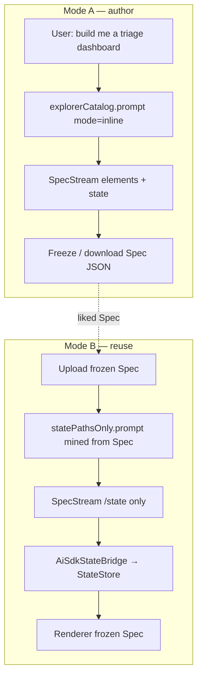

# VISION — Freeze the Spec, stream the state

> **Lab:** [`examples/chat`](../../) in `ai-json-render`.  
> **Classroom SSOT:** [`classroom/`](../../../classroom/README.md) (SpecStream, `pipeJsonRender`, dashboard split, catalog prompt).  
> **Official docs:** [Streaming / SpecStream](https://json-render.dev/docs/streaming) · on-disk twin [`apps/web/app/(main)/docs/streaming/page.mdx`](../../../../apps/web/app/(main)/docs/streaming/page.mdx).  
> **This plan changes the chat example.** It does not vendor `@meridian/*`.  
> **Status:** Milestone 1 shipped — see [`PRD.md`](./PRD.md) §0 + [`tickets/INDEX.md`](./tickets/INDEX.md).

---

## What we proved (in this lab, 2026-07-22/23)

We ran json-render chat end-to-end and dumped a real conversation:

| Artifact | Path |
|---|---|
| Envelope (AI SDK parts tape) | `fixtures/high-severity-clinical-history-review/trace-conv_jMMi0kX3a6oclD2A-envelope.json` |
| Folded Spec | `…/trace-conv_jMMi0kX3a6oclD2A-spec.json` |
| Catalog prompt snapshot | `fixtures/catalog-prompt/explorerCatalog.prompt.inline.txt` |

**Findings that are no longer hypotheses:**

1. **The LLM does not return a Spec object.** It streams **SpecStream** — JSONL RFC 6902 patches. `pipeJsonRender` sifts them into `data-spec` parts; `buildSpecFromParts` folds `{ root, elements, state }` ([streaming docs](https://json-render.dev/docs/streaming)).
2. **Prose + `` ```spec `` are one text stream**, classified mechanically — not two model calls.
3. **`$state` vs baked** is payload shape inside patches, not “patch vs no patch.”
4. **`catalog.prompt()` is persuasion + vocabulary**, not a fill lock. Stochastic models omit `/state` unless lucky or constrained elsewhere.
5. **Dashboard already ships Spec ⊥ state:** freeze Spec to DB, refill via **actions** + `StateProvider` — not via an LLM→StateProvider bridge ([`DashboardRenderer`](../../../dashboard/lib/render/renderer.tsx)).
6. There is **no** `VercelAiSdkJsonRenderStateProvider`. Closest: `StateProvider` + writers (actions on dashboard; SpecStream `/state` via **AiSdkStateBridge** in chat Mode B).

> **The “custom Spec” was a lie.** The Spec we want to reuse is a **chat-generated Spec we liked and froze.** Next turn we refill **state only**.

---

## The diagnosis, stated exactly

Chat today couples three jobs into one generative turn:

| Job | Who does it today |
|---|---|
| Invent layout (`/elements`) | LLM SpecStream |
| Seed data (`/state`) | LLM SpecStream (same fence) |
| Paint | `ExplorerRenderer` → `StateProvider initialState={spec.state}` |

That is perfect for **Mode A (author)**. It is the wrong shape for **Mode B (reuse)**: we already trust the tree; we only need data. Asking the model to re-emit `/root` + `/elements` risks layout churn and wastes the freeze.

Dashboard solved reuse with **REST actions**. We want the **same split**, with SpecStream `/state` patches (and later path-mined prompts) as an alternate **writer** into a `StateStore`.

---

## The load-bearing mechanic

From the streaming docs — SpecStream paths target the **Spec document**:

```
/root
/elements/<id>
/state/...          ← data seed living beside the tree
```

`$state` props point into the **state model** (often the same bytes after fold, or a live `StateStore`).

**AiSdkStateBridge** is the missing writer:

```
data-spec parts  (path starts with /state)
        ↓
  strip /state prefix → store pointer
        ↓
  StateStore.set / update
        ↓
  StateProvider store={…} + Renderer(frozenSpec)
```

`createSpecStreamCompiler` / `applySpecStreamPatch` already know how to apply patches ([`packages/core`](../../../../packages/core/src/types.ts)). The bridge **filters** to `/state` and **targets a store**, not a growing Spec tree.

---

## The two modes (the product shape)



**Mode A** already worked. **Mode B** needed the bridge first; prompt mining and upload UX followed — Milestone 1 closed that loop.

---

## What this plan builds (northstar)

1. **AiSdkStateBridge** — SpecStream `/state` → `StateStore` (testable without UI). ✅
2. **Freeze/reuse loop in chat** — dashboard’s `initialSpec` pattern + bridge as the state writer. ✅
3. **statePathsOnly prompt** — skip SpecStream layout teaching; request state for paths mined from the frozen Spec + catalog prop shapes. ✅
4. **Classroom stays the memory** — every ticket cites classroom notes; no Meridian package deps. ✅

Open (Milestone 2): envelope-persisted frozen Spec; Mode B export dump; fixture dedupe — [`tickets/INDEX.md`](./tickets/INDEX.md).

---

## What we refuse

- Vendoring `@meridian/chat` or inventing a second Spec format.
- Treating “baked Callout copy” as a bug in Mode A (chrome can be literal).
- A magical AI SDK `StateProvider` subclass that replaces `StateProvider` — **compose a writer instead**.
- Building Mode B UI before the bridge has green unit + live tests *(honored in Milestone 1)*.
- Claiming data completeness from `catalog.prompt()` alone.

---

## Success, one sentence

A clinician (or engineer) can **generate a Spec once**, freeze it, upload it on a new chat, and watch **only state stream in** while the same dashboard paints — proven by tests on the chat example’s OpenAI env.
