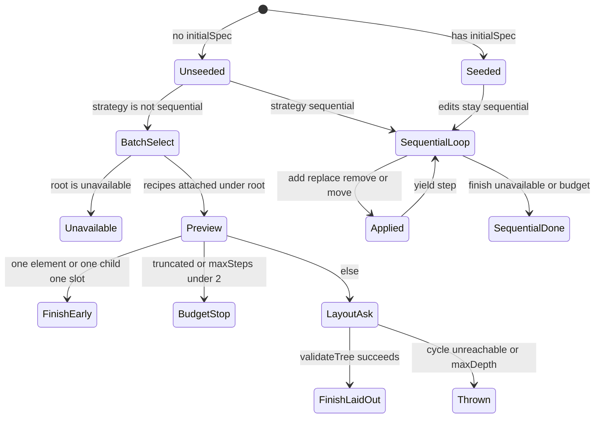

# What exact machinery turns a Jev prompt into a Spec?

Hub: [[HANDOFF-MEMORY]] · evaluator split: [[2026-10-09-hosts-do-not-use-the-gateway-evaluator]] · chat vs playground: [[2026-10-10-chat-domain-jev-decisions]] · journal: [[2026-10-10-journal]]

The public API is `experimental_composeSpec` (`packages/core/src/experimental-compose.ts`, re-exported at `packages/core/src/index.ts:234`). Jev is an evaluator behind that API, not a Spec generator.

## 1. The parts, named

| part | who owns it | what it may do | what it may not do |
|---|---|---|---|
| Catalog | host | name component types, prop schemas, slots, events, actions; `validate(spec)` | invent instances |
| Candidates | host `buildCandidates(prompt)` | supply atomic recipes: `id`, `description`, frozen `element` `{type, props, on?, visible?}`, optional `root` / `maxUses` / `resource` | be rewritten by the model |
| `initialState` | host | values the catalog schemas check against; copied onto the Spec | travel to the evaluator unless the host also puts a fact in `context` (`experimental-compose.ts:117-119`) |
| `context` / `instructions` / `elementDescriptions` | host | extra text the evaluator is allowed to read | change props |
| Evaluator | TypeSafe System One in these hosts; Gateway adapter exists unused | return one criteria key per Choice question | emit JSON UI, props, or new candidate ids |
| Composer | `@json-render/core` | ask Choice questions, clone recipes, `attach` / `detach` / `replaceElement`, `indexTree`, `catalog.validate`, `validateSpec` | execute actions (`experimental-compose.ts:270`) |

A candidate that is not atomic is refused before any evaluation (`validateCandidate`, `:150-168`): extra keys besides `type` / `props` / `on` / `visible` throw. V1 expressions allowed on those props: `$state`, `$bindState`, `$and`, `$or` only (`checkExpressions`, `:135-147`).

## 2. Dispatch: new tree vs edit

`experimental_composeSpec` (`:272`):

1. Clone candidates; build `{ root: "", elements: {} }` or `cloneInitialSpec(initialSpec)`.
2. Validate every candidate against the catalog using `initialState`.
3. Wrap `evaluate` with abort racing (`evaluateWithSignal`, `:222`) and `validateEvaluation` (`:240-265`): every question name must have `answers[name].choice` that is a key of that question's `criteria`; confidence if present is in `[0, 1]`.
4. **If `!initialSpec && strategy !== "sequential"` → `composeBatch` and return** (`:357-375`). Default `strategy` is unset, so a new tree is batched.
5. Otherwise the sequential loop (`:461-670`). Edits (`initialSpec` set) cannot take the batch path. Hosts do not pass `strategy`; they pass `initialSpec` when the client has a previous Spec (`apps/web/lib/jev/response.ts:48`, `examples/chat/lib/jev/response.ts:97`).

Default budgets in core: `maxSteps` 32, `maxDepth` 8, `maxElements` 32 (`:277-279`). Both hosts override to `maxSteps` / `maxElements` 14, `maxDepth` 4 (`apps/web/lib/jev/compose.ts:60-62`, `examples/chat/lib/jev/compose.ts:47-49`). Overall host deadline: `AbortSignal.timeout(55000)`.

## 3. Batch: two evaluations, preview first

`composeBatch` (`packages/core/src/experimental-composition-batch.ts`).

**Select** (`call("select", shared, questions)`, `:145`). One Choice question named `root` plus one `select_${i}` per candidate group. Groups: candidates sharing `resource` are one exclusive question; a candidate with `maxUses > 1` and no resource is a count question `0..min(maxUses, maxElements)` (`:102-144`). Independent groups are independent membership decisions, not a walk.

`shared` state sent to the evaluator (`:29-37`): `user_request`, `context`, `guidance` (`instructions.next`), `capabilities` as `{id, description}[]`. Not sent: prop objects, bindings, `initialState` values.

If `root` is `unavailable`, yield `complete` with `stopReason: "unavailable"` and stop (`:146-148`).

**Preview assemble** (`:180-195`): `node_0` is the root recipe; every other selected recipe is attached to the root's `default` slot (or the first slot if `default` is absent). `validate(spec)` then **yield `step`**. The caller already has a tree.

Skip layout and `complete("finish")` when `selected.length === 1`, or `selected.length === 2 && rootSlots.length === 1` (`:200-205`). Skip layout and `complete("limit")` when membership was truncated or `maxSteps < 2` (`:196-209`).

**Layout** (`:212-287`): for each non-root `node_*`, optional `parent_${id}` (when more than one legal parent/slot remains) and always `order_${id}` (global position among non-root selected, not per-parent siblings). Assemble on a **clone**, `validate(next)`, then publish. `indexTree` throws `"Spec contains unreachable elements."` at `experimental-composition-tree.ts:104`, or cycle / missing / `maxDepth` at `:82-85`.

`composeBatch` does **not** catch that throw. The generator rejects after the preview `step` was already yielded. Core test, `experimental-compose.test.ts:760-787`: cycle parents → `rejects.toThrow(/unreachable|cycle/)`, `events.length === 1`, preview still has four children on `node_0`. Docs (`apps/web/content/docs/jev.mdx:150`) say retain the last snapshot and label it incomplete; the **caller** must do that. The playground catch sends `__meta: error` after patches already streamed (`apps/web/lib/jev/response.ts:104-114`). Chat does the same after `data-spec` patches (`examples/chat/lib/jev/response.ts:140-156` and the following catch).

Live class, 2026-10-09 chat smoke: prompt `Show me the weather in Austin` returned HTTP 200, streamed 13 patches building an 11-element preview, then the body ended on `Spec contains unreachable elements.` Crypto metrics on the same host completed with a flat Spec. The Choice keys for that weather layout were not saved.

## 4. Sequential: one op per evaluation

Loop `for (let index = 0; index < maxSteps; index++)` (`experimental-compose.ts:461`). Each turn one `next` Choice question whose criteria are:

- add: candidate ids currently `canUse` (respects `maxUses` and exclusive `resource`)
- when `editing && !pending`: `replace:${id}`, `remove:${id}`, `move:${id}`
- when `pending.type === "move"`: `position:${i}` destinations
- `finish` only if the tree already has a root and nothing is pending
- always `unavailable`

Optional second question `parent` when there is more than one attach slot (`:564-571`). Evaluator state (`:573-587`): `user_request`, `already_built` (id / type / description / children / slots — **not** prop values), `changes_made` when editing, `context`.

Apply (`:631-667`): `finish` / `unavailable` break; else `replaceElement` / `detach`+`attach` / subtree delete / set `pending` / clone candidate onto `node_${n}` and `attach`. Then `validateTree()` and yield `step`. After the loop, yield `complete` with `spec: null` if there is still no root (`:672-679`).

## 5. What the hosts put on the table

Both hosts call the same public composer. They differ in catalog and recipes. Census measured 2026-10-09 by `research/tools/2026-10-09-candidate-census.ts` (control: re-run the file; the script reads `element.type`).

| host | catalog | candidates for an unquoted prompt | component types | exclusive resources |
|---|---|---|---|---|
| playground `apps/web/lib/jev/grammar.ts` | `playgroundCatalog` | **42** | **17**: Avatar, Badge, BarGraph, Button, Card, Checkbox, Grid, Heading, Input, Metric, Select, Separator, Stack, Switch, Table, Text, Textarea | 30 |
| chat `examples/chat/lib/jev/grammar.ts` | `explorerCatalog` | **28** | **12**: Badge, BarChart, Callout, Card, Grid, Heading, Link, Metric, Separator, Stack, Table, Text | 22 |

Quoted titles become extra Heading candidates via `/["“]([^"”\n]{1,80})["”]/g`, merged with a canned title list, unique, `.slice(0, 12)`:

- Playground canned titles already include `"Account settings"` (`grammar.ts:82-90`). Prompt `Change the heading to "Account settings"` stayed at **42** — the quote added no recipe.
- Chat canned titles are explorer names (`examples/chat/lib/jev/grammar.ts:109-115`). The same quoted prompt went **28 → 29** (`heading_5`).

Chat weather recipes are NYC / London / Tokyo (`platformState.weather`). There is no Austin row. Jev can still pick `weather_table` / city metrics; it cannot fetch Austin. Chat `context.platform` states that explicitly (`compose.ts:50-53`).

Playground `elementDescriptions` share string props `title` / `text` / `label` / `name` / `direction` (`apps/web/lib/jev/compose.ts:35-56`). Chat shares `title` / `text` / `label` / `content` / `name` (`examples/chat/lib/jev/compose.ts:29-42`). Field values in `initialState` stay off the wire unless a description already copied a display string.

## 6. How a Spec leaves the server

Playground (`apps/web/lib/jev/response.ts`): NDJSON. Each `step` → `diffToPatches` then `__meta: decision`. `complete` → remaining patches plus `__meta: composition` (`stopReason`, tokens, `estimatedCostUsd` from `inputTokens * 0.042 / 1e6` in `compose.ts:75-78`). Toggle `model === "typesafe-ai/jev"` in `apps/web/app/api/generate/route.ts:109`. Client forces `format: "jsonl"` for that model (`apps/web/lib/use-playground-stream.ts:155`).

Chat (`examples/chat/lib/jev/response.ts`): `createUIMessageStream`. A fixed text line "Composing from prepared sample data — not a live tool fetch.", then `SPEC_DATA_PART_TYPE` (`data-spec`) `{ type: "patch", patch }` per patch, then `{ type: "flat", spec }` on success. Toggle `body.model === "typesafe-ai/jev"` in `examples/chat/app/api/generate/route.ts:57`. Default chat is a `ToolLoopAgent` on OpenAI and is a different machine.

Both return **503** with no `TYPESAFE_API_KEY` before composing (`response.ts` playground `:49-56`, chat `:98-105`).

## 7. What the suite actually asserts

| file | `it(` count | what it covers |
|---|---|---|
| `packages/core/src/experimental-compose.test.ts` | 25 | sequential ops, batch select/layout, cycle-preserves-preview, depth limit |
| `packages/core/src/experimental-evaluator.test.ts` | 4 | Gateway URL and headers for `experimental_createEvaluator` |
| `apps/web/lib/jev/compose.test.ts` | 8 | playground recipes and limits |
| `apps/web/lib/jev/response.test.ts` | 4 | NDJSON / 503 |
| `examples/chat/lib/jev/compose.test.ts` | 4 | explorer recipes |
| `examples/chat/lib/jev/response.test.ts` | 3 | UI-message stream / 503 |

None of those tests call TypeSafe's network. Host evaluator tests stub the composer or the key.

## What is NOT known

- The parent/order Choice keys Jev returned for the 2026-10-09 Austin weather layout failure. The throw class is known; the answers are not.
- Whether `composeBatch` *should* catch layout failure and `complete` with the preview. The test documents today's throw. No owner ruling.
- Whether playground and chat catalog schemas (Text `content` vs other props; `BarGraph` vs `BarChart`; Table column shapes) will stay forked. Measured as different; not decided.
- Jev's internal scoring. This repo sees `choice` + `confidence` + (SDK) `probabilities`. Confidence is not treated as a quality gate (`jev.mdx:163`).
- Whether a prompt Jev cannot fulfill with prepared data consistently returns `unavailable` vs a layout throw vs a compact wrong tree. Only two live prompts were smoked.
