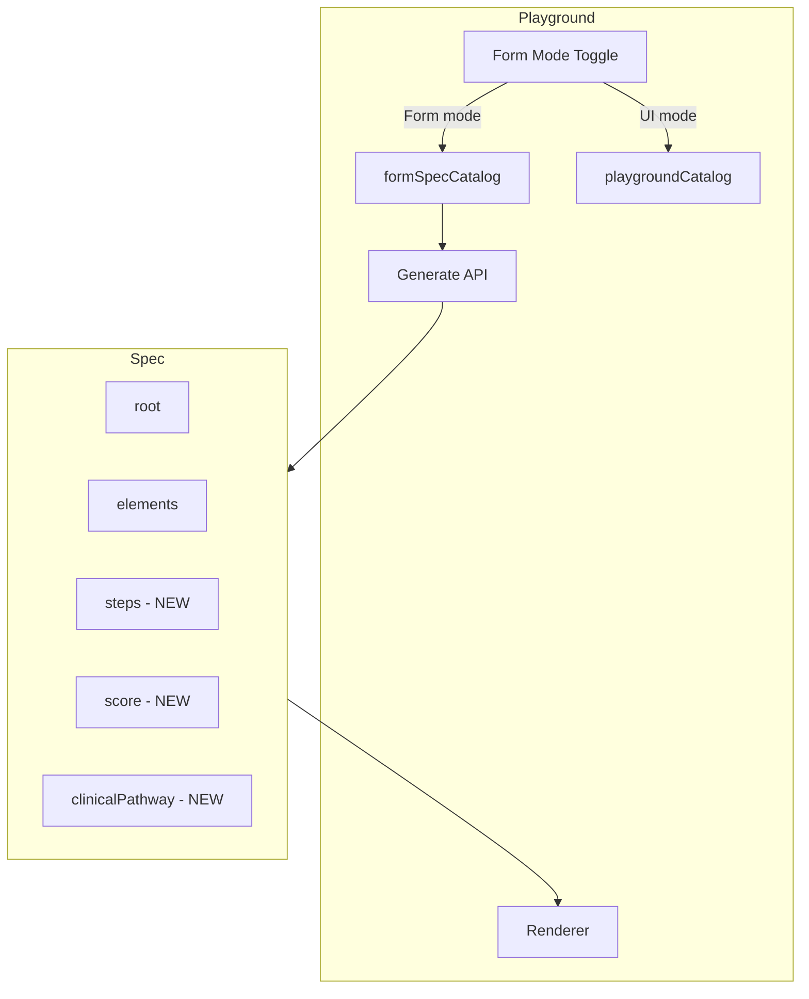

# FormSpec JSON Enhancement - Implementation Plan

## Goal

Enhance the playground to produce JSON specs that map naturally to F# FormSpec. Deliver in phases: Steps (Phase 1), Form fields catalog (Phase 2), Scoring (Phase 3), ClinicalPathway (Phase 4).

---

## Architecture Overview




---

## Phase 1: Steps

**Deliverable:** Step component, optional `steps` array in spec, AI generates multi-step forms.

### 1.1 Extend Spec Type and Schema

**Files:** [packages/core/src/types.ts](packages/core/src/types.ts), [packages/react/src/schema.ts](packages/react/src/schema.ts)

- Add optional `steps?: StepMeta[]` to `Spec` interface:

```ts
  interface StepMeta { key: string; order: number; label: string; }
  

```

- Extend react schema `spec` object with optional `steps: s.array(s.object({ key, order, label }))`
- Ensure `applySpecPatch` and parsing accept patches to `/steps` (e.g. `{"op":"add","path":"/steps", "value":[...]}`)

### 1.2 Add Step Component to Playground Catalog

**File:** [apps/web/lib/render/catalog.ts](apps/web/lib/render/catalog.ts)

- Add `Step` component:
  - props: `label`, `order`, `description?`
  - slots: `["default"]`
  - description: "Form section container. Use for multi-step forms. Children are the fields in this step."

### 1.3 Add Step to Registry

**File:** [apps/web/lib/render/registry.tsx](apps/web/lib/render/registry.tsx)

- Implement `Step`: render as Card or AccordionItem with label/order. Reuse existing Card/Accordion styling.

### 1.4 Update Prompt

**File:** [apps/web/app/api/generate/route.ts](apps/web/app/api/generate/route.ts)

- Add custom rule: "For multi-step forms: use Step as container for each section. Root can be first Step or a Stack of Steps. Output /steps array with { key, order, label } for each step."

### 1.5 Hooks / applyPatch

**File:** [packages/react/src/hooks.ts](packages/react/src/hooks.ts)

- Ensure `applySpecPatch` (or equivalent) handles `/steps` path. Check [packages/core/src/schema.ts](packages/core/src/schema.ts) `applySpecPatch` logic.

---

## Phase 2: Form Fields Catalog

**Deliverable:** `formSpecCatalog` with all FormSpec FieldTypes, form mode in playground.

### 2.1 Create formSpecCatalog

**New file:** `apps/web/lib/render/form-spec-catalog.ts`

- Define `fieldOption` schema: `{ value, description?, optionKey?, score? }`
- Components: Step, Form, Stack, Input (type: text|email|password|number|tel|search|color|date|datetime-local|time), Textarea, Radio, Select, Checkbox, CheckboxList, TagList, TextAutoComplete, Matrix, Signature, Message, ReadOnly, PluginField
- Input: extend type enum to include date, datetime-local, time, search, color
- Radio/Select/CheckboxList: options as `z.array(fieldOption)`
- Matrix: items, options (both fieldOption arrays), value as record
- PluginField: pluginId, fieldName, config (record)
- Reuse Form, Stack from existing catalog where possible; add new components

### 2.2 Add Form Mode Toggle to Playground

**Files:** Playground page component, API route

- Add "Form" vs "UI" mode (tab or toggle)
- When Form: use `formSpecCatalog` for system prompt; use form registry
- When UI: keep current `playgroundCatalog`

### 2.3 Form Registry

**New file:** `apps/web/lib/render/form-registry.tsx`

- Implement all form catalog components. For components that exist (Input, Textarea, Select, Checkbox, Radio): reuse or adapt from [apps/web/lib/render/registry.tsx](apps/web/lib/render/registry.tsx)
- New components: Step, CheckboxList, TagList, TextAutoComplete, Matrix, Signature, Message, ReadOnly, PluginField
- Matrix: render as table/grid of radio groups (rows = items, columns = options)
- Signature: placeholder or simple canvas (stub acceptable for Phase 2)
- PluginField: render placeholder "Plugin: {pluginId}"

### 2.4 Element Metadata (Optional for Phase 2)

- Add optional `fieldOrder`, `fieldKey`, `notes`, `isOptional`, `isDeprecated` to UIElement in types/schema if we want full FormField parity. Can defer to mapper phase.

---

## Phase 3: Scoring

**Deliverable:** Top-level `score` in spec, option-level `score` in fieldOption (already in Phase 2).

### 3.1 Extend Spec

- Add `score?: { maxScore: number; ranges: Array<{ min, max, label, tag }> }` to Spec
- Extend schema with optional score
- Prompt: "For scored forms, output score config: maxScore and ranges with min, max, label, tag (success|warning|danger|info|primary)."

### 3.2 Score Display (Optional)

- Add ScoreSummary component or display in form mode UI. Can be minimal (e.g. "Score: X / maxScore").

---

## Phase 4: ClinicalPathway (DONE)

**Deliverable:** Top-level `clinicalPathway` object in spec. No execution in playground; JSON structure only for mapper.

### 4.1 Define clinicalPathway JSON Shape

- States, Transitions, Conditions, Actions per [docs/form-spec/00-BRAINSTORM.md](docs/form-spec/00-BRAINSTORM.md)
- StateType: Evaluation, Action, CompoundAction, ConditionalAction, Terminal (Decision removed)
- Add to Spec type and schema as optional
- Prompt rules: "For clinical pathways, output clinicalPathway with states, transitions, conditions, actions. Reference element keys as field refs. Example: transition condition { scoreInRange: [10,27] } to state with action { referral: { target, urgency, reason } }."

### 4.2 Validation

- Schema validates structure (s.any for optional clinicalPathway). No pathway execution in playground.

---

## File Summary


| Phase | New Files                               | Modified Files                                                                |
| ----- | --------------------------------------- | ----------------------------------------------------------------------------- |
| 1     | —                                       | types.ts, schema.ts, catalog.ts, registry.tsx, route.ts, hooks.ts (if needed) |
| 2     | form-spec-catalog.ts, form-registry.tsx | Playground page, route.ts                                                     |
| 3     | —                                       | types.ts, schema.ts, form-spec-catalog prompt                                 |
| 4     | —                                       | types.ts, schema.ts, form-spec-fixture, route.ts, playground.tsx               |


---

## Open Questions (answer in plan)

1. **Scope:** Implement Phase 1 only first, or Phases 1+2 together? Phase 1 is ~1 day; Phase 2 adds significant catalog/registry work.  
  
Phase 1 + 2 toghether!
2. **Form mode UX:** Should Form mode be a separate tab (like "stream" vs "nested") or a top-level toggle that switches the entire playground behavior (catalog + prompt):  
  
You choose!
3. **Step rendering:** Should Step render as Card, AccordionItem, or a dedicated stepper (numbered steps with progress)? Card is simplest; stepper is more FormSpec-like:   
  
Accordion!!
4. **Schema extension strategy:** The react schema is shared. Adding `steps`, `score`, `clinicalPathway` as optional fields affects all catalogs. Is that acceptable, or should we create a separate `formSpecSchema` that extends the base? (Recommendation: add optional fields to base schema — they are ignored when absent.)  
  
Yes, shared! Optional to base! No separate!
5. **PluginField registry:** For Phase 2, is a placeholder ("Plugin: {pluginId} not loaded") sufficient, or do you have a plugin registry we should integrate with?  
  
Not loaded is suffifient for POC

  
  
We need to add a test with a fixture that expects the LLM to output a single form with all the supported features!